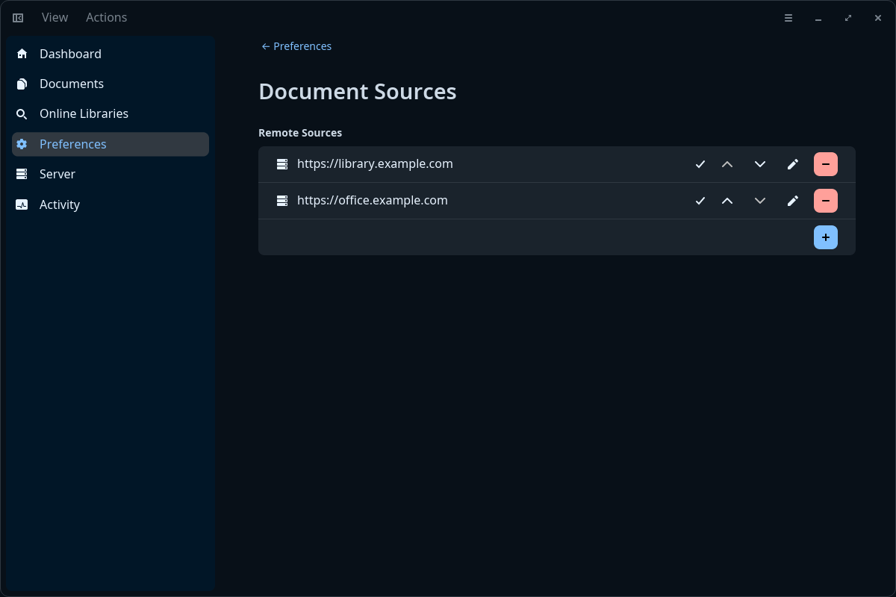
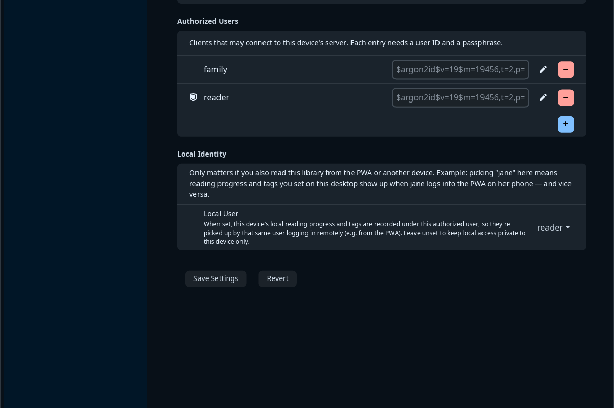
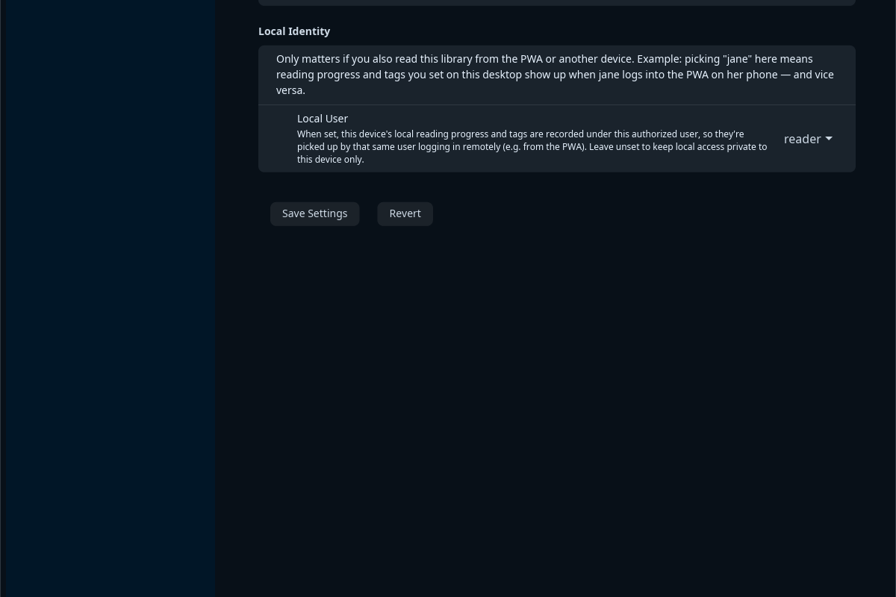

Both the web app (PWA) and the Cosmic desktop app can aggregate multiple Read Flow servers into
one combined library view — handy if you run a server at home and another elsewhere, want to
browse a family member's library alongside your own, or keep reading progress in sync across
every device you read on.

## Adding a source

### In the desktop app



Open **Preferences → Document Sources**, then click **+**, and fill in:

- **Remote URL**: the server's address, e.g. `http://192.168.1.10:8000`.
- **User ID**: a username configured on that server (see below).
- **Authorization token**: that user's password.

Cosmic checks reachability as you type and will let you add a source that's currently
unreachable — it appears as unreachable until the server comes back online.

### In the PWA

Open **Settings → Sources**, and click **Add source**. Fill in:

- **Name**: a label for this source, shown in the source list.
- **Base URL**: the server's address, e.g. `http://192.168.1.10:8000`.
- **User ID**: a username configured on that server (see below).
- **Passphrase**: that user's password.
- **Private mode**: check this to also pull private-tagged documents. It requires the `owner`
  role for that user on the remote server.

The PWA test-connects before saving, so a wrong URL or credential is caught immediately.

Document sources are stored in the database rather than in `read-flow.toml`.

## Creating a user on a server

Each Read Flow server has its own list of users. Remote clients sign in with one of them.



Open **Preferences → Server**, and under **Authorized Users**, click **+**. Fill in:

- **User ID**: the name the remote client enters as its **User ID**.
- **Passphrase**: the password the remote client enters. It must be at least 8 characters and
  contain at least one letter and at least one character that isn't a letter (a digit, a space, or
  a symbol, for example).
- **Owner Role**: turn this on to grant access to private content. Remote clients need it to use
  **Private mode**.

Passphrases are stored only as hashes, so the app can't show an existing one again. To change a
user's passphrase, edit the user and enter a new one.

The file stores each user with a hashed password and a list of roles:

```toml
[server.authorized_users.reader]
password = "$argon2id$..."  # generated by the app from the passphrase you enter
roles = ["owner"]

[server.authorized_users.family]
password = "$argon2id$..."
roles = ["reader"]
```

The table key (`reader`, `family`) is the **User ID**. A source only needs the `owner` role if you
also enable **Private mode** for it in the PWA. Read-only aggregation works with any configured role.

## Sharing reading progress with the desktop app



By default, reading progress and tags you set in the desktop app stay on that device. To have them
show up for one of the authorized users, for example when that user logs in from the PWA on a
phone, open **Preferences → Server → Local Identity** and pick that user under **Local User**.
The user must already exist under **Authorized Users**.

Once set, progress and tags recorded on this device are recorded under that user. Choose **None
(purely local)** to stop sharing.

The file stores this choice as `local_user_id` in the `[server]` section:

```toml
[server]
local_user_id = "reader"
```
