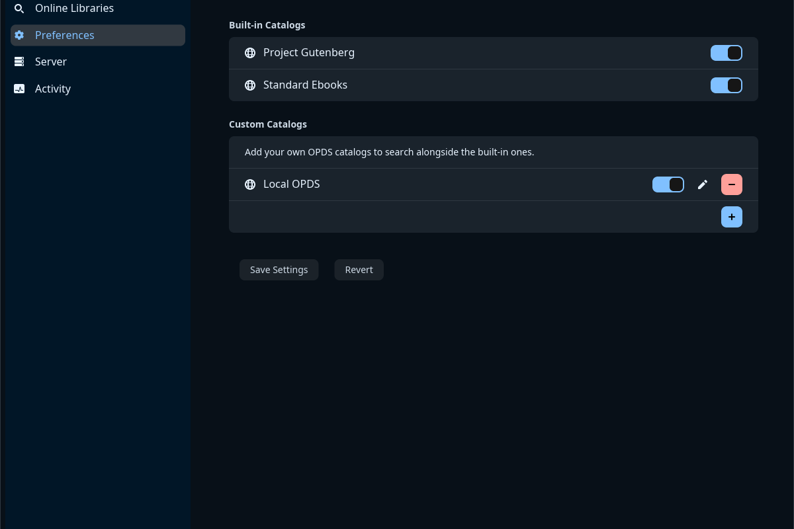

Read Flow can search OPDS catalogs and download titles straight into your library, without leaving
the app. Two public-domain catalogs are built in, and you can add your own.

## Managing catalogs



Open **Preferences → Online Library** to manage catalogs.

- **Built-in Catalogs**: Project Gutenberg and Standard Ebooks. Each has a switch that turns it on
  or off. Both are on by default.
- **Custom Catalogs**: catalogs you add yourself. Each one has a switch, an edit button and a
  remove button. Removing a catalog asks for confirmation first.

To add a custom catalog, click **+** under **Custom Catalogs**, and fill in:

- **Name**: the label shown for this catalog in search results.
- **Search URL**: the catalog's OPDS search address. Put `{searchTerms}` where the search text goes,
  for example `https://example.com/opds?q={searchTerms}`. If the URL has no `{searchTerms}`, Read
  Flow adds the search text as a `q` parameter instead.

Click **Save Settings** to keep your changes.

Catalogs are managed in the desktop app. The web app searches the same catalogs, because the server
runs the search.

The equivalent entries in `read-flow.toml` are shown at the end of this page.

## Searching and downloading

### In the desktop app

Open **Online Libraries** in the sidebar and type in the search field. Each result shows its title,
author, and the catalog it came from. Click a book to open its details, then click the button for the
format you want, such as EPUB or PDF. When the download finishes, the book is added to your library
and appears on the **Documents** page.

### In the PWA

Open **Online library** in the sidebar and search. Select a result to see its details, choose a
format, and download it. The book is added to the library on the server, and then it's available in
the web app like any other document.

## In read-flow.toml

Built-in catalogs are stored by id, with their enabled state:

```toml
[[online_library.catalogs]]
type = "builtin"
id = "project_gutenberg"
enabled = true

[[online_library.catalogs]]
type = "builtin"
id = "standard_ebooks"
enabled = true
```

A custom catalog stores its name and search URL:

```toml
[[online_library.catalogs]]
type = "configured"
name = "Local OPDS"
search_url = "https://opds.example.com/search?q={searchTerms}"
enabled = true
```
