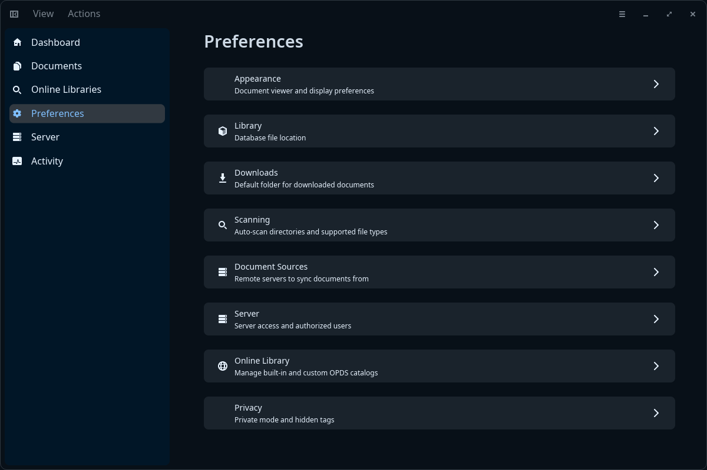
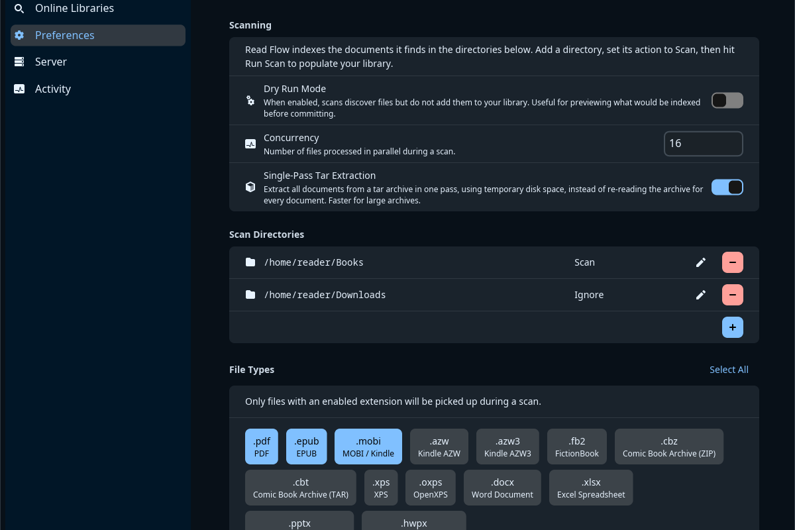
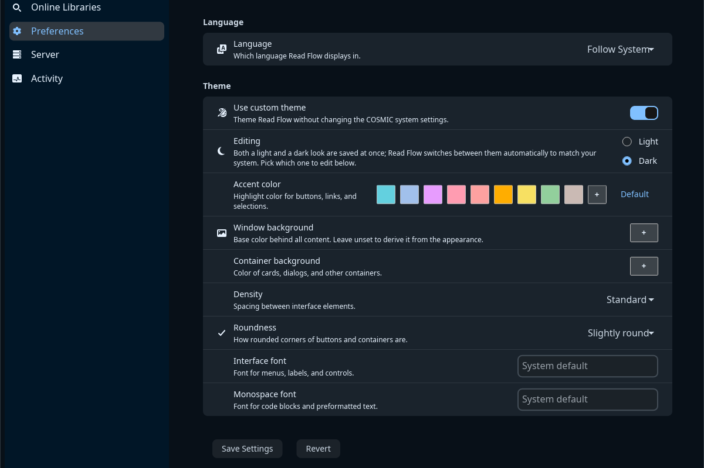
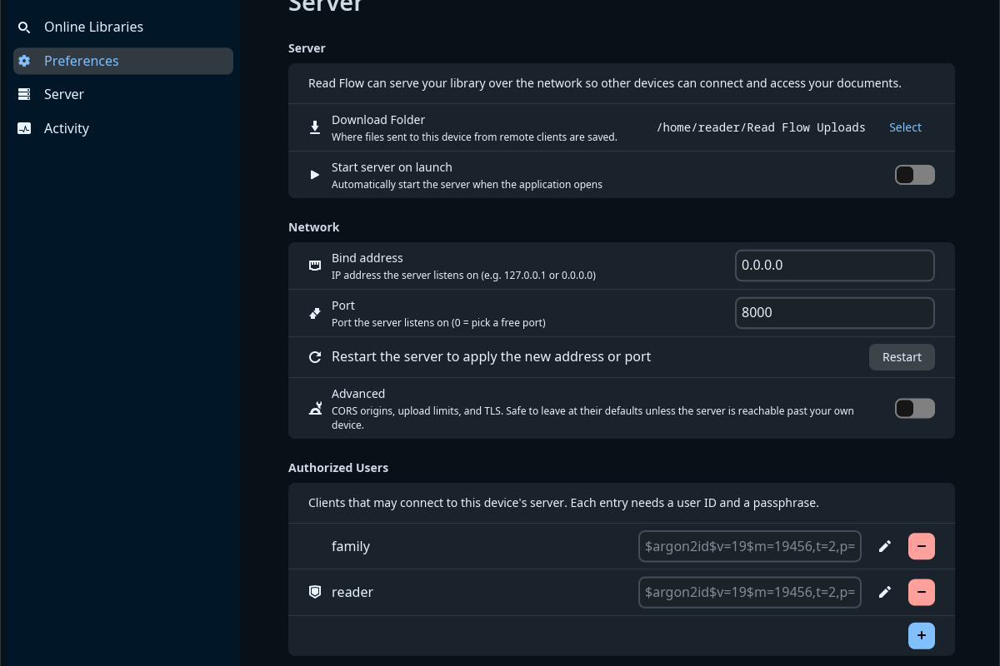
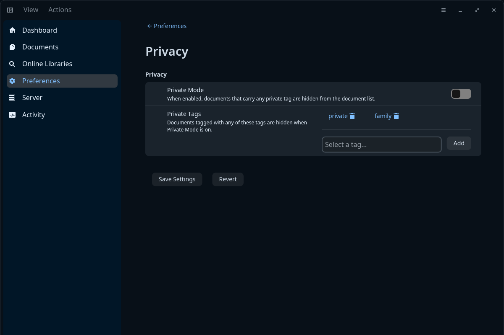

Read Flow stores its settings in a `read-flow.toml` file. You don't need to edit that file: each
setting has a control in the desktop app's **Preferences**. Each section below shows the screen
first, then the matching `read-flow.toml` section at the end, for reference.

`read-flow.toml` is written on first run. It's specific to your machine: it holds your server's
hashed credentials and local file paths, so it's never checked into version control and each
installation gets its own copy.

## Where settings live

| Preferences section | Stored in | Described in |
| ------------------- | --------- | ------------ |
| Appearance          | `[ui.theme]` | [Appearance](#appearance) |
| Library             | `[database]` | [Library](#library) |
| Downloads           | `[client]` | [Downloads](#downloads) |
| Scanning            | `[scan]` | [Scanning](#scanning) |
| Document Sources    | The database (not in the file) | [Multi-instance & remote sources](/guides/advanced/multi-instance/) |
| Server              | `[server]` | [Server](#server) |
| Online Library      | `[online_library]` | [OPDS catalogs](/guides/advanced/opds-catalogs/) |
| Privacy             | `[ui]` | [Privacy](#privacy) |

## Preferences



Open **Preferences** from the sidebar. Choose a section to change its settings, and use **Save
Settings** to keep your changes. **Revert** discards unsaved changes in that section.

## Library

Under **Preferences → Library**, **Database Location** sets where the SQLite file that stores your
document catalog and metadata lives. Restart the app after changing this path.

```toml
[database]
url = "database.db"
```

## Scanning



Read Flow finds documents in the directories listed under **Scan Directories**. To add one, click
**+**, choose the folder with **Select**, set its action and tags, and click **Save Directory**.
Then run a scan from the **Documents** page with **Run Scan**.

Each directory has these options:

- **Action**: **Scan** indexes the documents in this folder. **Ignore** skips a folder inside an
  already scanned tree.
- **Tags**: applied to everything found in this folder.
- **Inherit settings to subdirectories**: subfolders take this entry's tags and action unless they
  have their own entry.

The same section also has these options:

- **File Types**: only enabled file types are picked up during a scan.
- **Dry Run Mode**: scans report what they would index, without adding anything to your library.
- **Concurrency**: how many files are processed in parallel during a scan.
- **Single-Pass Tar Extraction**: extracts all documents from a tar archive in one pass, using
  temporary disk space.

```toml
[scan]
extensions = ["pdf", "epub", "mobi", "cbz"]
concurrency = 16
dry_run = false

[scan.directories."/home/reader/Books"]
action = "Scan"
tags = ["Library"]
inherit = true

[scan.directories."/home/reader/Downloads"]
action = "Ignore"
tags = []
inherit = false
```

## Appearance



**Language** sets the language Read Flow uses. The choices are English, Français and Nederlands.
**Follow System** is the default and uses your operating system's language. A change takes effect
immediately, without restarting.

**Theme** changes how Read Flow looks without changing your COSMIC system settings. Turn on **Use
custom theme** to set these options:

- **Editing**: Light and Dark looks are saved separately. Read Flow switches between them to match
  your system's current appearance. Choose which one you're editing here.
- **Accent color** and **Window background**. **Container background** sets the color of cards and
  dialogs.
- **Density** and **Roundness**: spacing between controls, and how rounded corners are.
- **Frosted glass** (with its strength): a translucent window background. This option only appears
  on COSMIC on Wayland, where the compositor supports blur.
- **Interface font** and **Monospace font**. The monospace font applies to code blocks and
  preformatted text.

```toml
[ui.theme]
enabled = true
density = "Standard"
roundness = "SlightlyRound"
frosted = true
frosted_strength = "Medium"
interface_font = "Inter"
monospace_font = "JetBrains Mono"

[ui.theme.light]
accent = "#008040"
background = "#e0fff0"

[ui.theme.dark]
accent = "#008040"
background = "#081810"
```

## Downloads

Under **Preferences → Downloads**, **Download Folder** sets where files you download from a remote
source are saved.

```toml
[client]
download_folder = "/home/reader/Downloads"
```

## Server



The **Server** section controls whether Read Flow serves your library to other devices:

- **Download Folder**: where files sent to this device by remote clients are saved.
- **Start server on launch**: starts the server when the app opens.
- **Bind address** and **Port**: the address and port the server listens on. `0.0.0.0` listens on
  every network interface, `127.0.0.1` only on this device, and port `0` picks a free port. Click
  **Restart** to apply a new address or port.
- **Advanced**: shows CORS origins, the upload size limit and HTTPS settings. These are safe at
  their defaults unless the server is reachable beyond your own device. See
  [HTTPS & TLS](/guides/advanced/reverse-proxy-tls/) for HTTPS.

Authorized users and the local identity are in the same section. See
[Multi-instance & remote sources](/guides/advanced/multi-instance/).

```toml
[server]
address = "0.0.0.0"
port = 8000
download_folder = "/home/reader/Read Flow Uploads"
local_user_id = "reader"
allowed_origins = ["https://read-flow.example.com"]
max_upload_bytes = 104857600
```

`allowed_origins` is empty by default, which allows any origin. `max_upload_bytes` is in bytes:
the example above is 100 MiB.

## Privacy



**Private Mode** hides documents that carry any of the **Private Tags** from the document list.
Add or remove tags in that list, then click **Save Settings**.

```toml
[ui]
private_mode = false
private_tags = ["private", "family"]
```

## Running headless

On a home server or NAS, you can skip the desktop window entirely:

```bash
read-flow --headless --address 0.0.0.0 --port 8000
```

See [Headless server + PWA](/guides/advanced/headless-pwa/) for the full walkthrough, and
[Multi-instance &amp; remote sources](/guides/advanced/multi-instance/) if you're connecting more
than one Read Flow server from the same web app.
